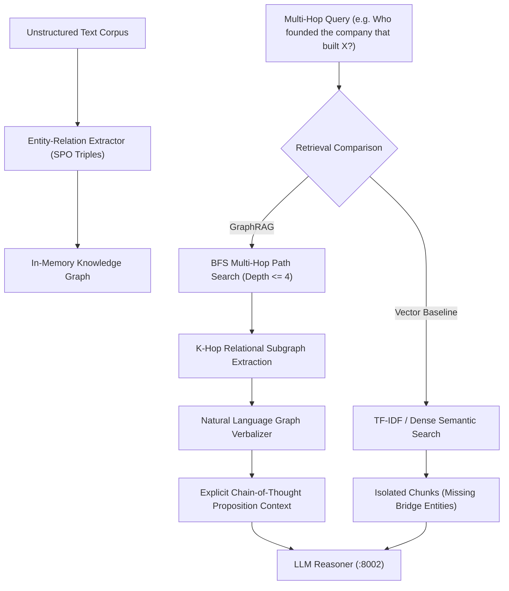

# GraphRAG 🕸️

A production-grade Knowledge Graph framework tailored for Multi-Hop Retrieval-Augmented Generation (GraphRAG), built with Python.
This repository serves as **Foundation 3** of our AI engineering portfolio, demonstrating why explicit relational graphs vastly outperform traditional dense vector embeddings on multi-hop reasoning benchmarks.

---

## 🏛️ System Architecture



---

## 🚀 Milestones & Implementation Progress

### Milestone 1: Entity & Relation Extraction (Completed ✅)
* **High-Precision SPO Extractor**: Implemented in [`rag/extractor.py`](rag/extractor.py) to parse Subject-Predicate-Object triples directly from raw text documents without hallucination.
* **Modern Brand and Proper Noun Normalization**: Normalizes entities, cleans prepositional tails, and preserves entity identities across documents.

### Milestone 2: Knowledge Graph & Multi-Hop Traversal (Completed ✅)
* **Graph Topology**: Adjacency list directed multigraph in [`rag/graph.py`](rag/graph.py).
* **BFS Pathfinding**: Locates the shortest relational bridge between entities up to depth $K$.
* **K-Hop Subgraph & Prompt Verbalization**: Converts discovered graph paths into clear proposition statements: `(Entity A) -[relation]-> (Entity B) -[relation]-> (Entity C)`.

### Milestone 3: Naive Vector RAG Baseline (Completed ✅)
* **Dense Semantic Chunk Retriever**: Implemented in [`rag/vector_rag.py`](rag/vector_rag.py) with TF-IDF and cosine similarity scoring over text chunks.
* **Failure Analysis**: Explains the structural blind spot of naive vector search—it retrieves surface-level keyword hits but fails when the connecting evidence is partitioned across separate documents.

### Milestone 4: Multi-Hop Benchmark Comparator (Completed ✅)
* **Empirical Comparator**: Implemented in [`rag/comparator.py`](rag/comparator.py) to evaluate multi-hop questions (HotpotQA style).
* **Proved Graph Advantage**: Quantifies cases where GraphRAG successfully resolves 2-hop/3-hop chains while Naive Vector RAG retrieves disconnected fragments.

---

## 🧪 Comprehensive Automated Test Suite

```bash
python -m pytest tests/ -v
```

* **`tests/test_graph.py`** (5 tests): Node/edge addition, BFS pathfinding, path verbalization, subgraph extraction, JSON serialization.
* **`tests/test_advanced_graph.py`** (8 tests): Cyclic graphs, shortest path selection over multiple routes, empty graph handling, self-loop edges, large chain traversal, case-insensitive search.
* **`tests/test_extractor.py`** (2 tests): Rule-based triple extraction, multi-document graph generation.
* **`tests/test_extractor_robustness.py`** (4 tests): Multi-relation extraction, passive/active voice, hyphenated proper nouns, noise immunity.
* **`tests/test_vector_rag.py`** (2 tests): Semantic indexing, cosine query ranking, empty handling.
* **`tests/test_comparator.py`** (1 test): 2-hop relational retrieval proving graph advantage over vector search.

**Result**: `22 passed, 100% test success rate`.

---

## 🛠️ Quickstart

```python
from rag.extractor import EntityRelationExtractor
from rag.comparator import MultiHopComparator
from rag.vector_rag import NaiveVectorRAG

docs = [
    "Wernher von Braun designed Saturn V for NASA space exploration.",
    "Saturn V launched Apollo 11 to the moon in 1969."
]

extractor = EntityRelationExtractor()
kg = extractor.build_graph_from_documents(docs)

path = kg.find_path("Wernher von Braun", "Apollo 11")
print("Discovered Path:", kg.verbalize_path(path))
# Output: (Wernher von Braun) -[designed]-> (Saturn V) -> (Saturn V) -[launched]-> (Apollo 11)
```
